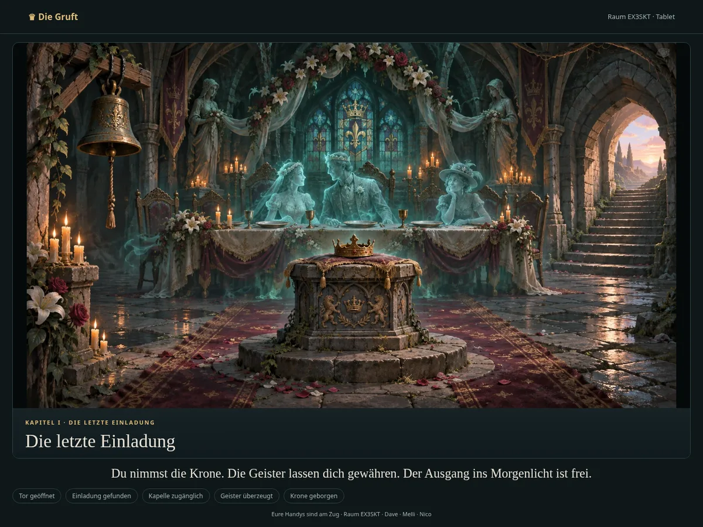

# Die Gruft des falschen Königs

**[Direkt online spielen – ohne Installation](https://gruft-des-falschen-koenigs.furrybeetle.chatgpt.site)**

Auf dem Tablet öffnen, Raum erstellen, mit den Handys den QR-Code scannen. Die Anleitung zum lokalen WLAN-Server unten ist optional.

Ein kooperatives Dungeon-Abenteuer für **2–6 Spieler**, etwa 15–30 Minuten. Das erste Kapitel **„Die letzte Einladung“** führt durch drei illustrierte Räume mit mehreren Lösungswegen und unterschiedlichen Enden.

Das **Tablet zeigt nur die Szene und die aktuelle Erzählung**. Auf den **Handys schreiben alle in einen gemeinsamen Chat**, was sie tun. Untersuchen, Gegenstände aufnehmen, Schlösser öffnen, mit Geistern verhandeln und weitergehen funktionieren über freie Sätze. Es gibt keine Aktionsmenüs. Für riskante Versuche braucht ihr einen echten W20.

[Handy-Ansicht ansehen](docs/handy.webp)

## Sofort im WLAN spielen

Voraussetzung: **Node.js 24 oder neuer** auf einem Laptop oder Rechner. Tablet und Handys brauchen nur einen Browser. Alle Geräte müssen im selben WLAN sein.

1. Projekt herunterladen und entpacken.
2. Windows: `STARTEN.bat` öffnen. macOS/Linux: im Projektordner `npm start` ausführen (alternativ `sh starten.sh`). Für das Spielen ist **kein `npm install` erforderlich**.
3. Auf dem Tablet eine der im Terminal angezeigten **WLAN-Adressen** öffnen. Nicht `localhost`: Diese Adresse funktioniert nur auf dem Serverrechner.
4. Auf dem Tablet **„Auf dem Tablet öffnen“** wählen.
5. Mit jedem Spielerhandy den QR-Code scannen, Namen eingeben und beitreten. Bei mindestens zwei Spielern **auf einem Handy** aufbrechen.
6. Frei schreiben, beispielsweise „Ich schaue mich um“. Raumwechsel schlägt jemand im Chat vor; eine Mehrheit kann mit eigenen Sätzen wie „Ich stimme zu“ folgen. Ein echter W20 wird nur angefordert, wenn ein Versuch riskant ist.

Zum Ausprobieren ohne Freunde: auf dem Rechner `http://localhost:8788` öffnen und **„Allein ausprobieren“** wählen. Für getrennte Tablet-/Handy-Tests mehrere Browserprofile oder private Fenster verwenden.

Der Rechner muss während der Runde eingeschaltet bleiben. Spielstände und der gesamte Chat liegen in `gruft.sqlite`; ein Neuladen oder Serverneustart verliert den Fortschritt nicht. Für einen erneuten Versuch einen **neuen Raum** öffnen. Alte Spielstände aus dem früheren Abenteuer werden erkannt und nicht überschrieben.

Falls ein Handy die Adresse nicht erreicht: kein Gäste-WLAN mit Gerätesperre verwenden und den lokalen Netzwerkzugriff für Node.js in der Firewall erlauben. Alternativer Port: `npm run build` und danach `npm run dev -- --port 8790` ausführen.

## Was die Spielleitung kann

Dieser Abschnitt läuft **ohne Higgsfield, ohne API-Schlüssel und ohne laufende KI-Kosten**. Der Erzähler erkennt Absichten und Varianten mit einem lokalen Regelwerk. Gemeinsamer Besitz, geöffnete Wege, Alarm, Entschuldigungen und Zugeständnisse werden auf dem Server gespeichert. Kurze Folgeeingaben wie „Ich öffne sie“ beziehen sich auf das zuletzt angesprochene Objekt. Ein unklarer Satz löst eine Rückfrage aus und erfindet keine Gegenstände oder Erfolge.

Das ist **keine unbegrenzt improvisierende Sprachmodell-Spielleitung**: Ungewöhnliche Ideen außerhalb der vorhandenen Regeln können eine genauere Formulierung brauchen. Es gibt mehrere vorbereitete Wege, darunter Gewalt, Verhandlung, Ablenkung und das Nutzen sichtbarer Gegenstände. Verneinte und hypothetische Handlungen führen keine Aktion aus. Bei einem Raumwechsel während des Tippens bleibt der Entwurf erhalten, damit ihr ihn auf die neue Szene abstimmen könnt.

Pro Raum gibt es eine zusammenhängende Illustration mit natürlich eingebauten Objekten. Das Bild zeigt die Ausgangsszene; die aktuelle Erzählung und die Fortschrittsanzeige dokumentieren Veränderungen. Es gibt keine nachträglich aufgemalten Objekt-Overlays.

## Entwicklung und Prüfen

- `npm start`: baut das Projekt und startet den WLAN-Server auf Port 8788.
- `npm test`: prüft das neue Kapitel und die erhaltene frühere Spielelogik.
- `npm install` und `npx playwright install chromium`: optionale Browser-Testabhängigkeiten installieren.
- `npm run test:browser`: spielt den gesamten Abschnitt mit Tablet und drei voneinander getrennten Handy-Sitzungen durch. Screenshots liegen danach unter `work/`.
- `CHROMIUM_PATH` kann einen vorhandenen Chromium-Browser für den Test auswählen.

`chapter.mjs` enthält die aktuelle Welt und ihre Regeln, `client.js` die Ansichten, `worker.mjs` die HTTP-Schnittstelle und `lan.mjs` den SQLite-Server. `game.mjs`, `world.mjs` und `improv.mjs` bewahren den früheren Projektstand und seine Tests. **Die Weltdateien enthalten Spoiler.**

Ein reines GitHub-Pages-Hosting reicht für die gemeinsame Runde nicht aus: Sie benötigt den mitgelieferten Server.
