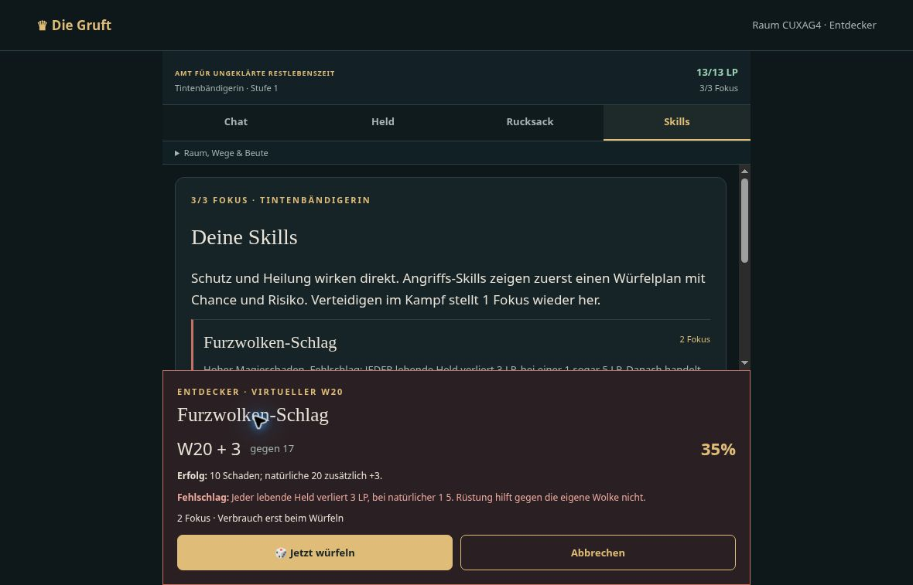

# Die Gruft des falschen Königs · Dungeon-Crawler

**[Direkt online spielen](https://gruft-des-falschen-koenigs.furrybeetle.chatgpt.site)**

Tablet: Raum öffnen. Handys: QR-Code scannen, Namen eingeben, Klasse wählen. Danach startet ein Handy die Expedition. 2–6 Spieler; zum Ausprobieren gibt es einen Solo-Modus. Internet genügt, ein gemeinsames WLAN oder Rechner ist nicht nötig.

## Die Kündigung des Königs

Eine komplette Expedition mit fünf illustrierten Dungeon-Räumen, drei möglichen Monsterbegegnungen, persönlichen Charakterblättern, Beute und einem Boss. Das Skelettamt wird von Günther von Klammer-zurück geleitet. Klaudia Kassensturz ist eine Truhe mit Bissvertrag. Im Thronsaal wartet Dieter, der Kündigungsteppich, mit König Horst dem Vorläufigen als unbezahltem Reiter.

Das Tablet zeigt immer den aktuellen Raum, die Erzählung, Gruppen-LP und im Kampf das Monster samt angekündigtem Angriff. Die Dinge in der Kulisse gehören zu den Spielregeln: Gong, Becken, Fallgitter, Flasche, Kettenwinden, Archivtruhe, Gästebuch, Buffetglocke und Kronleuchter können untersucht oder genutzt werden. Illustrationen zeigen die Ausgangsszene; Status und Erzählung dokumentieren Änderungen.

Auf jedem Handy gibt es vier Tabs: **Chat, Held, Rucksack und Skills**. Weltaktionen bleiben frei formulierte Sätze. Beispielsweise „Ich untersuche die Winde“, „Ich greife Günther an“, „Ich verteidige mich“ oder „Ich helfe Melli auf“. Inventar und Skills sind zusätzlich direkt bedienbar. Bei unklaren Absichten fragt die lokale regelbasierte Spielleitung nach. Sie ist kein unbegrenzt improvisierendes Sprachmodell und benötigt keinen API-Schlüssel.

## Charaktere und Entwicklung

Sechs Klassen mit unterschiedlichen LP, Attributen, Waffen und Skills:

- **Thekenritter:** Gruppenschutz und kräftige Waffenangriffe.
- **Schlachtkoch:** Heilung und das Pfannenfinale.
- **Tintenbändigerin:** riskanter Furzwolken-Schlag und späteres Monsterzähmen.
- **Nuggetmönch:** Monsterangriff unterbrechen und starke Heilung.
- **Sonnenpakt-Hexe:** magische Angriffe mit einem gefährlichen stärkeren Skill.
- **Pfandflaschen-Schurke:** Geschickangriffe und Rauchschutz.

Erfahrung gibt es für abgeschlossene Begegnungen, auch für eine friedliche Lösung der Mimic-Begegnung. Stufen 2–4 liegen bei 4/8/14 EP. Jeder Aufstieg bringt +3 maximale LP, +1 Hauptattribut und einen frei verteilbaren Talentpunkt. Auf Stufe 2 wird der zweite Klassenskill frei. Talente, Ausrüstung und Begleiter bleiben während der Expedition erhalten; nach dem Ende könnt ihr die Charakterblätter weiter ansehen. Ein neuer Raum startet neue Helden, keine permanente Account-Kampagne.

Beute liegt zunächst im Raum. Der erste erfolgreiche Aufnehmer bekommt sie in seinen persönlichen Rucksack. Waffen und Rüstung können zwischen Kämpfen gewechselt, nicht ausgerüstete Gegenstände an Freunde weitergegeben werden. Questgegenstände werden gemeinsam geführt. Gold ist in der Kapelle nach der Rast gegen Vorräte eintauschbar.

## Virtueller Würfel und faire Risiken

Der Server würfelt den W20 mit `crypto.getRandomValues` und Rejection Sampling. Ein vom Handy mitgesendeter Würfelwert wird ignoriert. Bei einer natürlichen 1 misslingt der Versuch immer; eine 20 gelingt kritisch und verursacht bei Angriffen +3 Schaden.

Vor einem riskanten Einsatz zeigt der Würfelplan Attributbonus, Zielwert, genaue Erfolgschance, Fokuskosten, Erfolg und Fehlschlag. Bis zum Wurf kann der aktive Spieler kostenlos abbrechen. Nach dem Wurf werden Fokus, Schaden und Zug verbindlich gespeichert; kein erneuter Wurf derselben Aktion.

**Furzwolken-Schlag:** 2 Fokus, W20 + Magie gegen 17, 10 Basisschaden plus Stufen-/Talentbonus. Bei Magie 3 sind das 35 % Erfolg. Fehlschlag: alle zuvor stehenden Helden verlieren 3 LP, bei natürlicher 1 sind es 5 LP. Eigene Rüstung schützt nicht vor dieser Wolke. Das kann eine Gruppe besiegen. Der stärkere Hexen-Skill hat entsprechend andere Werte, die ebenfalls vor dem Wurf angezeigt werden.

## Kämpfe

Das Monster kündigt vor jeder Runde Ziele und Basisschaden an. Jeder stehende Held handelt in fester Zugfolge einmal; erst dann erfolgt genau der angekündigte Monsterangriff. Untersuchungen kosten keinen Zug. Mehr Spieler erhöhen Monster-LP und die Anzahl angekündigter Ziele.

- **Verteidigen:** 4 persönlicher Schutz und +1 Fokus.
- **Thekenritter-Schutz:** 3 Schutz für alle beim nächsten Monsterangriff.
- **Nuggetmönch:** ein Monsterangriff fällt aus, einmal pro Kampf.
- **Raumvorteil:** eine gelungene Aktion an der Einrichtung verursacht Schaden und schwächt den nächsten Monsterangriff; einmal erfolgreich pro Begegnung.
- **Heilen/Aufhelfen:** kostet im Kampf den Zug, kann bewusstlose Freunde zurückholen.
- **Rückzug:** Mehrheit der stehenden Helden, nur in einen besuchten Raum, 2 LP Schaden je stehender Figur. Das Monster behält seine LP.

Heilmittel und Fokus sind begrenzt. In der Kapelle gibt es nach Einladung und Buffetglocke **genau eine volle Rast**. Es gibt kein automatisches Vollheilen nach jedem Kampf. Liegt die ganze Gruppe am Boden, ist die Expedition verloren.

## Testen und lokal starten

Online ist kein Setup nötig. Für die optionale lokale Version: Node.js 24+ und `npm start` oder `STARTEN.bat`; zum Spielen ist kein `npm install` erforderlich. Spielstände liegen lokal in `gruft.sqlite`, online in der bestehenden D1-Datenbank.

- `npm test`: aktuelle Crawler-Regeln und archivierte Vorgängerversionen.
- `npm run build`: Worker mit allen Kulissen und dem Client erzeugen.
- `npm install`, `npx playwright install chromium`, `npm run test:browser`: optionaler Browser-Test für Tablet, zwei getrennte Handy-Sitzungen, Klassenwahl, persönliche Tabs, Skill-Vorschau und echten virtuellen Würfel. Dieser Test hängt nicht von einem bestimmten Würfelergebnis ab.

`crawler.mjs` enthält die aktuelle Spielwelt und Regeln. `chapter.mjs`, `game.mjs`, `world.mjs` und `improv.mjs` bewahren die früheren Versionen samt Tests. Alte Online-Runden werden erkannt und nicht überschrieben; für den Crawler muss eine neue Runde erstellt werden. **Die Weltdateien enthalten Spoiler.**
